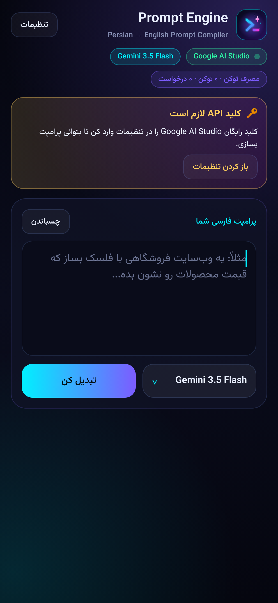
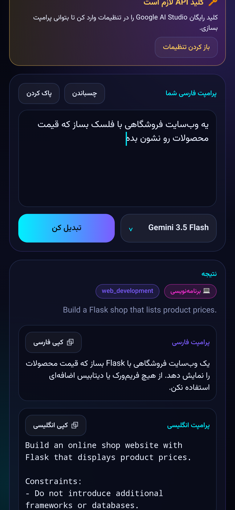
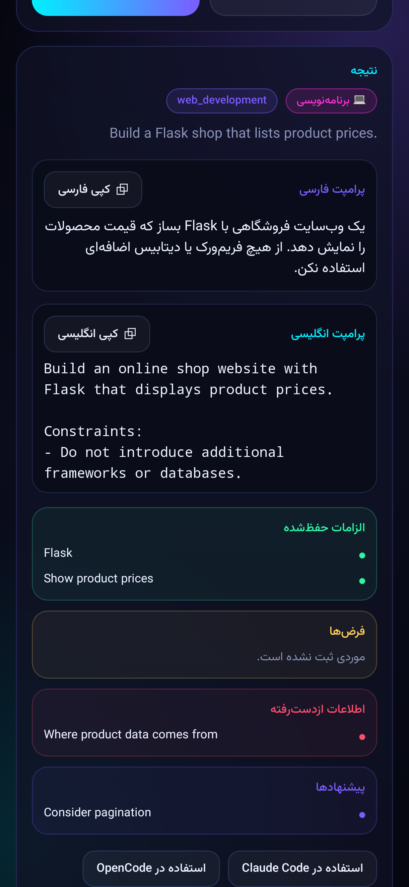
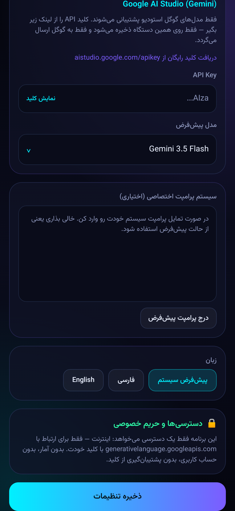

<div align="center">


# Prompt Engine — Android

**Persian → English Prompt Compiler, native on your phone**
**کامپایلر پرامپت فارسی به انگلیسی، بومی روی اندروید**

[English](#-english) · [فارسی](#-فارسی)

</div>

<div align="center">
   
</div>

---

# 🇬🇧 English

## What is it?

**Prompt Engine** is a native Android app (Kotlin + Jetpack Compose) that compiles natural Persian requests into
production-grade, executable English prompts for AI coding agents and LLMs — Claude Code, OpenCode, ChatGPT, Gemini and more.

It is a faithful Android port of the open-source [Astr0Net/PromptCompiler](https://github.com/Astr0Net/PromptCompiler)
web app: same compiler policy (the system prompt is byte-for-byte the original), same Gemini request, same response parser,
same model catalog and the same usage/quota tracking.

### Why a compiler, not a translator?

```text
Persian input ─► Intent analysis ─► canonical english_prompt  (single source of truth)
                                         ├─► faithful persian_prompt (translated FROM the English)
                                         ├─► preserved_requirements
                                         ├─► assumptions
                                         ├─► missing_information
                                         └─► suggestions (kept outside the prompt)
```

* **Zero-hallucination** — never invents frameworks, databases, libraries or features.
* **Hard constraints stay hard** — "Do not use PostgreSQL" is never weakened.
* **10 intent categories** — coding, debugging, research, writing, image_generation, translation, data_analysis, planning, automation, general.
* **Proportional output** — short request → short prompt.

## Features on Android

* Neon dark RTL UI with the Vazirmatn font; full **Persian + English** interface (switch in Settings).
* Model picker with the complete Gemini catalog (usable text models + greyed-out unsupported ones).
* One-tap **copy** (English / Persian), **Use in Claude Code / OpenCode**, and Android **Share**.
* **Share-to-app**: select text anywhere → Share → *Prompt Engine*.
* Live **token usage** + RPD / TPM / RPM meters for the selected model (rolling 7-day local history).
* Custom **system-prompt override** (or insert the built-in one and edit it).
* Adaptive + themed (monochrome) launcher icon.

## Install

1. Download [`releases/PromptEngine-2.0.0.apk`](releases/PromptEngine-2.0.0.apk) (≈ 2–3 MB, a single file — no more split parts).
2. Allow *Install unknown apps* for your browser/file manager, then open the APK.
3. Requires Android 7.0 (API 24) or newer.

SHA-256 of the APK: see [`releases/PromptEngine-2.0.0.apk.sha256`](releases/PromptEngine-2.0.0.apk.sha256).

> Upgrading from the old 1.0.x (Python/Chaquopy) build? Uninstall it first — it was signed with a different key.

## Keys & permissions (all in **Settings**)

| What | Where | Notes |
|---|---|---|
| **Google AI Studio API key** | Settings → API Key | Free at <https://aistudio.google.com/apikey>. Stored only on your device; sent only to `generativelanguage.googleapis.com`. |
| Default model | Settings → Default model | Any Gemini text model from the catalog. |
| Custom system prompt | Settings → System prompt | Optional. Empty = built-in compiler prompt. |
| Interface language | Settings → Language | System / فارسی / English. |
| Android permission | — | Only **INTERNET**. No accounts, analytics, ads, or cloud backup of your key. |

## Build from source

```bash
# JDK 17+, Android SDK (platform 35, build-tools 35)
echo "sdk.dir=/path/to/android-sdk" > local.properties
./gradlew testDebugUnitTest      # unit tests (parser, Gemini client, usage, policy prompt)
./gradlew assembleRelease        # app/build/outputs/apk/release/app-release.apk
```

Release signing uses `keystore.properties` / `PE_*` env vars if present; otherwise the repository's open sideload keystore
(`release.keystore`) so that updates install over each other. **Do not treat that key as secret** — fork and replace it for your own distribution.

## Project layout

```text
app/src/main/java/com/astr0net/promptcompiler/
├── data/           Catalog · PromptEngine (parser) · Gemini (HTTP) · Usage · Settings · Compiler
├── ui/             Theme · Components · MainScreen · ModelPicker · UsageSheet · SettingsScreen
├── MainActivity.kt · MainViewModel.kt · PromptEngineApp.kt
app/src/main/assets/system_prompt.txt   the original compiler policy
fastlane/metadata/android/{en-US,fa}/   store listing (title, short + full description, changelog, icon)
```

---

# 🇮🇷 فارسی

<div dir="rtl">

## این برنامه چیست؟

**Prompt Engine** یک اپلیکیشن بومی اندروید (Kotlin + Jetpack Compose) است که درخواست‌های فارسی را به پرامپت‌های انگلیسیِ دقیق و قابل‌اجرا برای ایجنت‌ها و مدل‌های هوش مصنوعی (Claude Code، OpenCode، ChatGPT، Gemini و …) کامپایل می‌کند.

این اپ، پورت وفادارِ پروژه متن‌باز [Astr0Net/PromptCompiler](https://github.com/Astr0Net/PromptCompiler) روی اندروید است: همان سیاست کامپایلر (سیستم‌پرامپت عیناً از پروژه اصلی)، همان درخواست Gemini، همان پارسر خروجی، همان کاتالوگ مدل‌ها و همان ردیابی مصرف و سهمیه.

### چرا «کامپایلر» و نه «مترجم»؟

* **صفر توهم** — هیچ فریم‌ورک، دیتابیس، کتابخانه یا قابلیتی از خودش اضافه نمی‌کند.
* **محدودیت‌ها سخت می‌مانند** — «از PostgreSQL استفاده نکن» هرگز نرم نمی‌شود.
* **۱۰ دسته هدف** — برنامه‌نویسی، دیباگ، ریسرچ، نوشتن، ساخت تصویر، ترجمه، تحلیل داده، برنامه‌ریزی، اتوماسیون، عمومی.
* **خروجی متناسب** — درخواست کوتاه، پرامپت کوتاه.
* پرامپت انگلیسی مرجع نهایی است و نسخه فارسی ترجمه‌ی وفادارِ همان است (نه کامپایل دوباره).

## امکانات نسخه اندروید

* رابط تیره نئونی راست‌به‌چپ با فونت وزیرمتن؛ **فارسی + انگلیسی** کامل (از تنظیمات عوض می‌شود).
* انتخاب مدل با کاتالوگ کامل Gemini (مدل‌های متنی قابل‌استفاده + مدل‌های غیرقابل‌استفاده به‌صورت خاکستری).
* **کپی** با یک لمس (انگلیسی / فارسی)، **استفاده در Claude Code / OpenCode** و **اشتراک‌گذاری** اندروید.
* **دریافت متن از اپ‌های دیگر**: متن را انتخاب کن ← اشتراک‌گذاری ← *Prompt Engine*.
* **مصرف توکن زنده** + نوار RPD / TPM / RPM برای مدل انتخابی (تاریخچه ۷ روزه محلی).
* **سیستم‌پرامپت اختصاصی** (یا درج پرامپت پیش‌فرض و ویرایش آن).
* آیکون تطبیقی و تم‌پذیر (monochrome).

## نصب

۱. فایل [`releases/PromptEngine-2.0.0.apk`](releases/PromptEngine-2.0.0.apk) را دانلود کن (حدود ۲ تا ۳ مگابایت، **یک فایل واحد** — دیگر خبری از پارت‌های جدا نیست).
۲. برای مرورگر یا فایل‌منیجر گزینه «نصب از منابع ناشناس» را فعال کن و APK را باز کن.
۳. حداقل اندروید ۷٫۰ (API 24).

هش SHA-256 فایل: [`releases/PromptEngine-2.0.0.apk.sha256`](releases/PromptEngine-2.0.0.apk.sha256).

> اگر نسخه قدیمی ۱٫۰٫x (پایتون/Chaquopy) را داری، اول آن را حذف کن؛ با کلید دیگری امضا شده بود.

## کلیدها و دسترسی‌ها (همه در **تنظیمات**)

| چه چیزی | کجا | توضیح |
|---|---|---|
| **کلید API گوگل استودیو** | تنظیمات ← API Key | رایگان از <https://aistudio.google.com/apikey>. فقط روی دستگاه خودت ذخیره می‌شود و فقط به `generativelanguage.googleapis.com` ارسال می‌گردد. |
| مدل پیش‌فرض | تنظیمات ← مدل پیش‌فرض | هر مدل متنی Gemini از کاتالوگ. |
| سیستم‌پرامپت اختصاصی | تنظیمات ← سیستم پرامپت | اختیاری. خالی یعنی پرامپت پیش‌فرض کامپایلر. |
| زبان رابط | تنظیمات ← زبان | پیش‌فرض سیستم / فارسی / English. |
| دسترسی اندروید | — | فقط **اینترنت**. بدون حساب کاربری، بدون آمار و تبلیغ، بدون پشتیبان‌گیری ابری از کلید. |

## ساخت از سورس

```bash
# JDK 17+ و Android SDK (platform 35 و build-tools 35)
echo "sdk.dir=/path/to/android-sdk" > local.properties
./gradlew testDebugUnitTest      # تست‌های واحد (پارسر، کلاینت Gemini، مصرف، سیستم‌پرامپت)
./gradlew assembleRelease        # app/build/outputs/apk/release/app-release.apk
```

امضای نسخه نهایی از `keystore.properties` یا متغیرهای `PE_*` خوانده می‌شود؛ در غیر این صورت از کیدی‌استور متن‌بازِ مخزن (`release.keystore`) استفاده می‌شود تا نسخه‌ها روی هم نصب شوند. **این کلید محرمانه نیست** — برای انتشار شخصی، فورک کن و آن را عوض کن.

</div>

---

<div align="center">

Inspired by / الهام‌گرفته از [Astr0Net/PromptCompiler](https://github.com/Astr0Net/PromptCompiler)

</div>
